# GenerativeArt Studio

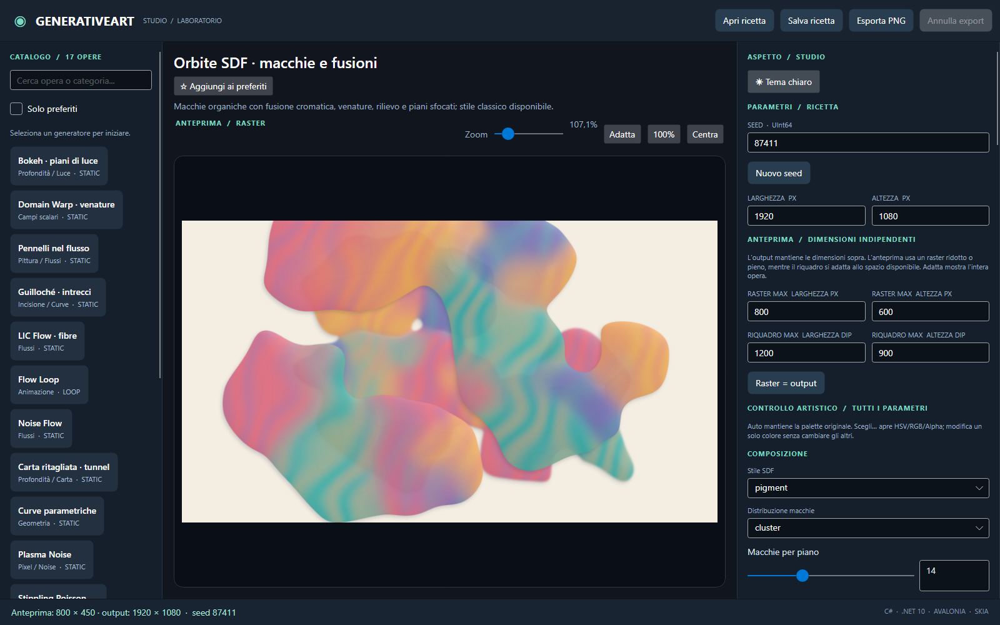

GenerativeArt è un'applicazione desktop **C#/.NET 10** per creare arte generativa con **Avalonia** e **SkiaSharp**. Lo Studio e la CLI condividono lo stesso motore. Le ricette JSON conservano seed, dimensioni, algoritmo e parametri per riprodurre le opere.

Il catalogo comprende **30 generatori**, 30 preset incorporati e 216 ricette di esempio: flussi, pennelli, macchie SDF, paesaggi, incisioni, mosaici, pattern e campi di rumore. Cincinnus offre pennellate a setole con distribuzione Simple/Adaptive, tre palette e otto pigmenti modificabili singolarmente. Il mosaico Voronoi può sovrapporre più piani, con tessere mancanti, smussi illuminati, ombre e fondo sfocato. Colori e trasparenza, dettagli, ombre e finiture cartacee sono regolabili dall'editor.

Tutti i generatori offrono un profilo **4K UHD con supersampling 2×**: il calcolo avviene a 7680×4320 e il PNG finale misura 3840×2160, adatto anche a ritagli di dettaglio. Sono supportati il formato verticale e dimensioni personalizzate fino a 4096 px per lato e 8.847.360 pixel finali. L'anteprima statica usa la risoluzione finale; **Adatta** e **100%** controllano la visualizzazione. Il progetto supporta ricette animate e sequenze di fotogrammi per i generatori compatibili. L'export 8K UHD resta disponibile nei percorsi geometrici già previsti: Guilloché, Voronoi piatto, Streamlines distanziate e Stippling Poisson.

## Galleria degli algoritmi

Ogni miniatura mostra un render del progetto. Selezionala per aprire la ricetta JSON corrispondente; seed, colori e parametri sono modificabili nello Studio.

| | | |
| :---: | :---: | :---: |
| **Alien Letters · glifi modulari**<br>[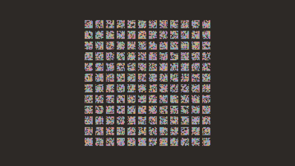](examples/recipes/production-4k/alien-letters.json) | **Bokeh · piani di luce**<br>[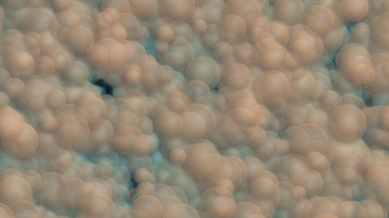](examples/recipes/production-4k/bokeh-depth.json) | **Cincinnus · pennellate fluenti**<br>[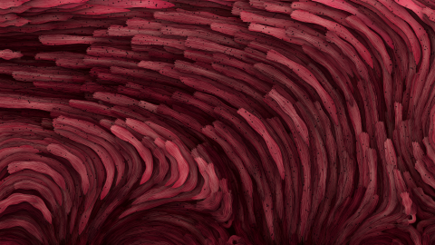](examples/recipes/production-4k/cincinnus-bristles.json) |
| **Cotton Circles · tasselli semicircolari**<br>[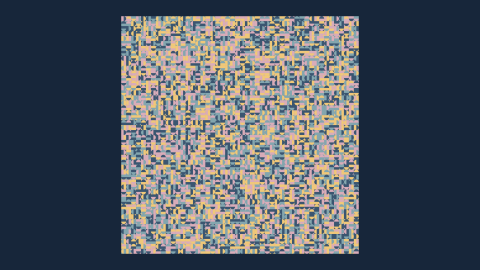](examples/recipes/production-4k/cotton-circles.json) | **Crinis · fasci di setole**<br>[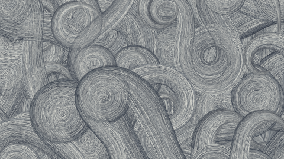](examples/recipes/production-4k/crinis-bristles.json) | **Domain Warp · venature**<br>[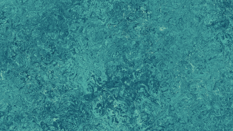](examples/recipes/production-4k/domain-warp.json) |
| **Eclectic · tracce in collisione**<br>[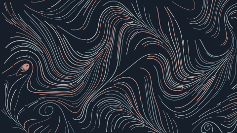](examples/recipes/production-4k/eclectic-trails.json) | **Fascia · nastri d'inchiostro**<br>[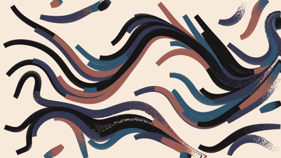](examples/recipes/production-4k/fascia-ribbons.json) | **Pennelli nel flusso**<br>[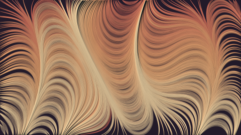](examples/recipes/production-4k/flow-brush.json) |
| **Guilloché · intrecci**<br>[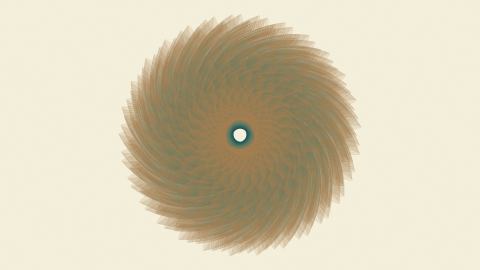](examples/recipes/production-4k/guilloche.json) | **LIC Flow · fibre**<br>[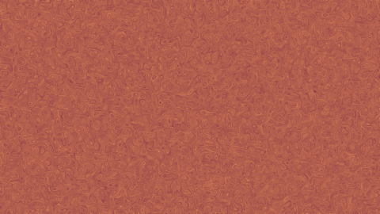](examples/recipes/production-4k/lic-flow.json) | **Flow Loop**<br>[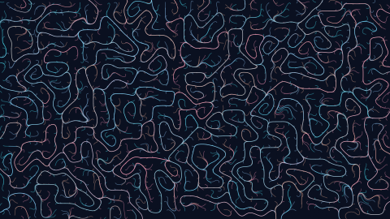](examples/recipes/production-4k/looping-flow.json) |
| **Noise Flow**<br>[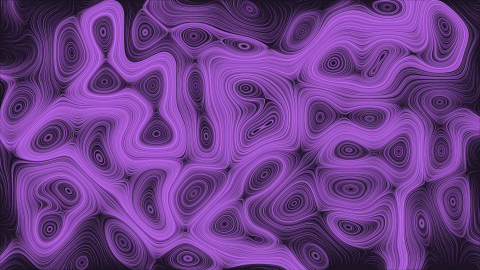](examples/recipes/production-4k/noise-flow.json) | **Ocellus · occhi stratificati**<br>[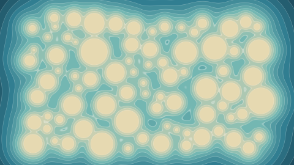](examples/recipes/production-4k/ocellus-eyespots.json) | **Carta ritagliata · tunnel**<br>[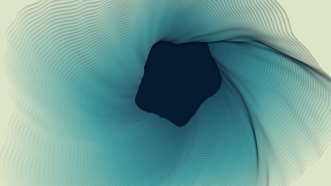](examples/recipes/production-4k/paper-cut.json) |
| **Curve parametriche**<br>[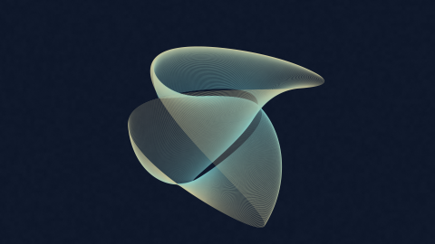](examples/recipes/production-4k/parametric-curves.json) | **Fillotassi · spirali botaniche**<br>[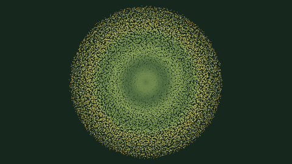](examples/recipes/production-4k/phyllotaxis.json) | **Plasma Noise**<br>[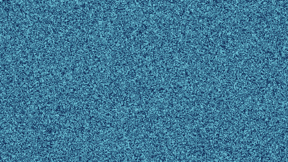](examples/recipes/production-4k/plasma-noise.json) |
| **Stippling Poisson**<br>[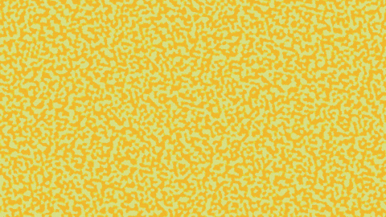](examples/recipes/production-4k/poisson-stippling.json) | **Reazione–diffusione · Gray–Scott**<br>[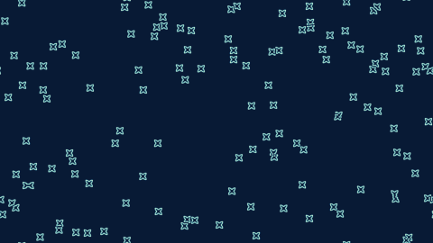](examples/recipes/production-4k/reaction-diffusion.json) | **Rete · schiuma cellulare**<br>[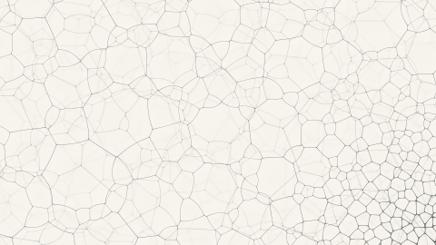](examples/recipes/production-4k/rete-foam.json) |
| **Rigor · griglia tipografica**<br>[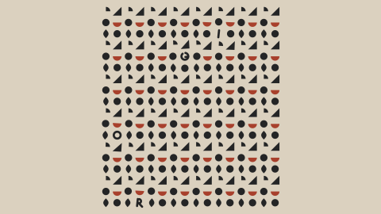](examples/recipes/production-4k/rigor-grid.json) | **Orbite SDF · macchie e fusioni**<br>[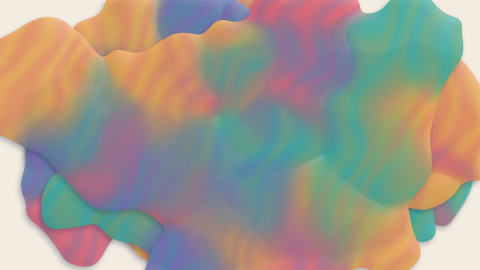](examples/recipes/production-4k/sdf-orbits.json) | **Streamlines distanziate**<br>[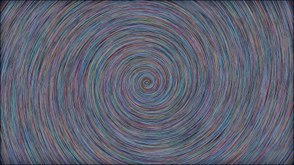](examples/recipes/production-4k/spaced-streamlines.json) |
| **Flamebrush · spirali puntinate**<br>[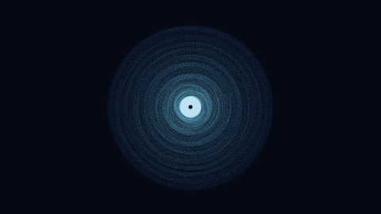](examples/recipes/production-4k/spiral-flamebrush.json) | **Paesaggi a strati**<br>[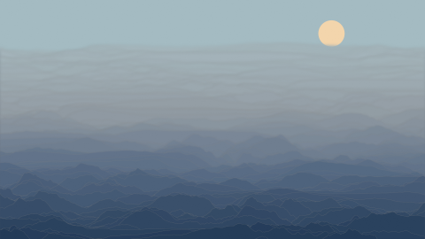](examples/recipes/production-4k/strata-landscape.json) | **Incisione · tratteggio**<br>[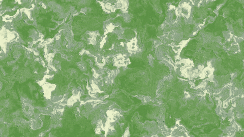](examples/recipes/production-4k/tonal-engraving.json) |
| **Curve topografiche**<br>[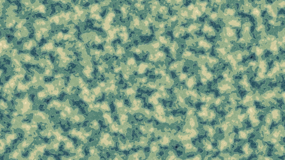](examples/recipes/production-4k/topographic-contours.json) | **Mosaico Voronoi**<br>[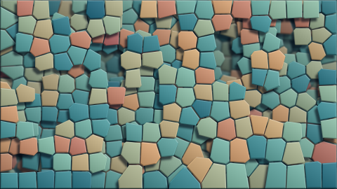](examples/recipes/production-4k/voronoi-layered.json) | **Interferenze d'onda · Moiré**<br>[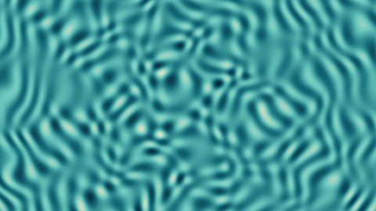](examples/recipes/production-4k/wave-interference.json) |

## Installazione su Windows

Servono **.NET SDK 10**, compatibile con `global.json`, e una connessione NuGet per il primo ripristino. Estrai il progetto e apri PowerShell nella cartella che contiene `GenerativeArt.sln`:

```powershell
dotnet restore .\GenerativeArt.sln
dotnet build .\GenerativeArt.sln -c Release --no-restore
```

## Esecuzione

Avvia lo Studio con lo script, che ripristina le dipendenze e compila in Release:

```powershell
.\run.ps1
```

Per avviare una compilazione esistente usa `.\run.ps1 -NoBuild`; per la configurazione Debug usa `.\run.ps1 -Configuration Debug`.

Per eliminare tutte le cartelle `bin` e `obj` del progetto:

```powershell
.\clean.ps1
```

Puoi vedere quali cartelle verranno eliminate con `.\clean.ps1 -WhatIf`. Le cache NuGet vengono conservate. Gli script funzionano anche se richiamati da un'altra cartella; dopo la pulizia, `.\run.ps1` ricompila lo Studio.

Scegli un generatore, modifica i parametri e osserva l'anteprima. **Apri ricetta** carica uno degli esempi in [examples/recipes](examples/recipes); **Salva ricetta** conserva le impostazioni ed **Esporta PNG** genera l'immagine.

Per un background ad alta risoluzione premi **4K · qualità massima**, sotto larghezza e altezza. Imposta il formato UHD, il supersampling 2× e i massimi valori di densità, campioni e iterazioni pertinenti all'algoritmo; conserva seed, palette e scelte compositive. I parametri restano modificabili. Per mantenere il dettaglio corrente scegli invece **Profilo di lavorazione → production**, imposta le dimensioni e **Campionamento raster → fine-2x**. I render più densi possono richiedere alcuni minuti. Le ricette pronte si trovano in [examples/recipes/production-4k](examples/recipes/production-4k).

Per il Voronoi con profondità scegli **Composizione del mosaico → layered**, oppure apri una ricetta in [examples/recipes/voronoi-depth-v1](examples/recipes/voronoi-depth-v1).

La CLI permette di elencare i generatori e renderizzare una ricetta:

```powershell
New-Item -ItemType Directory -Path .\output -Force | Out-Null

dotnet run --project .\src\GenerativeArt.Cli -c Release --no-build -- list
dotnet run --project .\src\GenerativeArt.Cli -c Release --no-build -- describe cincinnus-bristles

dotnet run --project .\src\GenerativeArt.Cli -c Release --no-build -- render-recipe .\examples\recipes\cincinnus-c5\cincinnus-simple-crimson-768.json .\output\cincinnus-simple.png
dotnet run --project .\src\GenerativeArt.Cli -c Release --no-build -- render-recipe .\examples\recipes\cincinnus-c5\cincinnus-adaptive-ocean-768.json .\output\cincinnus-adaptive.png
dotnet run --project .\src\GenerativeArt.Cli -c Release --no-build -- render-recipe .\examples\recipes\voronoi-depth-v1\voronoi-depth-glass-windows-1920.json .\output\voronoi-profondo.png

dotnet run --project .\src\GenerativeArt.Cli -c Release --no-build -- prepare-4k .\examples\recipes\voronoi-depth-v1\voronoi-depth-glass-windows-1920.json .\output\voronoi-4k.json
dotnet run --project .\src\GenerativeArt.Cli -c Release --no-build -- render-recipe .\output\voronoi-4k.json .\output\voronoi-4k.png
```

La destinazione deve essere nuova: la CLI non sovrascrive file esistenti. Aggiungi `--keep-complexity` a `prepare-4k` per conservare la densità e il dettaglio della ricetta originale.
