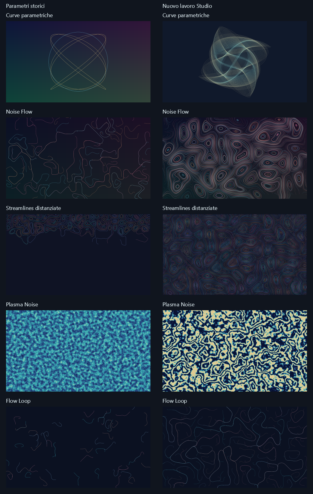

# M4D.2-R1 — Pennelli, paesaggi ed evoluzione dei generatori iniziali

16 novembre 2026. L'utente richiede nuovi algoritmi/ricette e più ricchezza nei primi generatori. **15 generatori, 63 ricette, 733/733 test Windows**. Due nuove famiglie pittoriche e cinque generatori iniziali ampliati, con preset artistici per i nuovi lavori dello Studio.

## Confronto dei generatori iniziali

Stesso seed **42**, output **1920×1080**; nel loop è mostrato il frame 0. A sinistra i parametri storici, a destra quelli dei nuovi lavori dello Studio. La riduzione usa la media d'area 4×4 con alpha premoltiplicato per conservare i tratti fini.



Parametri esatti in [`validation/M4D2_R1_comparison-parameters.json`](validation/M4D2_R1_comparison-parameters.json). Il comando `compare` del tool riproduce il confronto.

| Generatore | Controlli aggiunti e risultato |
| --- | --- |
| Curve parametriche | Composizioni harmonic/woven, frequenze X/Y, fase, curve sovrapposte, scala interna, twist, rotazione, proporzioni, precisione, spessore e anello opzionale. Il nuovo lavoro parte con 28 curve intrecciate. |
| Noise Flow | Fino a 10000 linee, campi curl/vortice/braid oltre al campo storico, partenze random/griglia/bordi, frequenza, torsione, passi, lunghezza del passo, spessore e opacità. Nuovo lavoro: 1200 tracce su curl. |
| Plasma Noise | fBm, turbulence, ridged e marble; rapporto frequenze, persistenza, venature, rotazione, proporzioni, contrasto, gamma e incisione dei contorni. Nuovo lavoro: marmo a cinque ottave. |
| Streamlines distanziate | Scelta del campo curl/vortice/braid, frequenza, passi per direzione, passo massimo e opacità, oltre a distanza/spessore già disponibili. Nuovo lavoro: massimo 3000 linee, distanza 6,5 e frequenza più ampia. |
| Flow Loop | Densità esplicita, passi, frequenza, passo di integrazione, spessore e opacità. Nuovo lavoro: 220 tracce da 240 passi, con layout più uniforme. |

La torsione del Noise Flow controlla il campo angolare storico/braid; la frequenza agisce sui campi noise/braid. Il vortice è geometrico. In Plasma il numero di bande controlla le venature marble e i contorni quando attivi. Non tutti i parametri hanno effetto in ogni modalità.

Per curve più leggere ridurre layers e spessore; per flussi più pieni aumentare lines/steps insieme alla distribuzione a griglia. Per Plasma diminuire frequency quando si desiderano strutture grandi, poi regolare contrasto/gamma e contour-strength. Nei flussi storici, modificare solo opacità o spessore conserva le traiettorie: una variazione di colore non seleziona una geometria diversa.

## Pennelli nel flusso

Artwork `flow-brush`. `OrganicStroke` in Algorithms costruisce setole intorno a una polilinea con normali locali, profilo di pressione, estremi rastremati e irregolarità seeded. Il renderer traccia in entrambe le direzioni e disegna una setola alla volta, comprese le ombre quando richieste; non conserva tutte le pennellate in memoria.

| Gruppo | Controlli |
| --- | --- |
| Campo | field curl/vortex/braid, frequency e curvature dell'intreccio |
| Composizione | strokes 1–600; partenze random, grid o edge |
| Dettaglio | steps 16–800 per direzione, step-size 0,5–6 |
| Pennello | bristles 2–40; brush-width 1–120; bristle-width 0,1–3; taper 0–4; roughness 0–1 |
| Pigmento | opacity 0,02–1; shadow 0–0,5; tre pigmenti e sfondo indipendenti |
| Finitura | standard/fine-2x, carta, grana, pigmenti e dithering comuni |

Larghezza, spessore e passi pittorici sono riferiti a un lato minimo di 1000 px. Il pennello si adatta quindi alle dimensioni e alla preview proporzionale. Più setole aumentano il dettaglio interno; brush-width amplia la pennellata senza imporre setole più spesse. Taper controlla la pressione e il restringimento alle estremità. Per un effetto asciutto usare poche setole sottili, roughness alta e shadow bassa o zero.

## Paesaggi a strati

Artwork `strata-landscape`. `FractalProfile1D` produce profili continui e seeded con ottave, persistenza e deformazione del dominio. Gli strati vengono disegnati dal fondo al primo piano con palette progressiva, attenuazione atmosferica, bordi e ombre morbide in tre passaggi.

| Gruppo | Controlli |
| --- | --- |
| Composizione | layers 3–120, horizon 0,02–0,7 |
| Rilievo | height 0,01–0,4; frequency 0,3–12; layer-drift 0–2; tilt −0,5…0,5; profile soft/ridge/waves |
| Dettaglio | octaves 1–7; persistence 0,1–0,9; warp 0–3; samples 128–4096 |
| Luce | atmosphere 0–1; shadow 0–0,5; shadow-width 0,5–24; sole con raggio e posizione indipendenti |
| Tratto e colori | edge-width 0–5, quattro colori degli strati, cielo, bordi/ombre e sole |

Con layer-drift basso gli strati seguono profili simili; aumentandolo si differenziano. Atmosphere schiarisce gli strati lontani verso il cielo. Edge-width zero elimina i bordi, sun-radius zero nasconde il sole. Ombre e bordi scalano sul lato minimo di 1000 px. Si tratta di un renderer di paesaggi; il compositore generale di livelli/maschere/blend M4C.3 resta futuro.

## Nuovi lavori e compatibilità

`StudioRecipeDefaults.ParametersFor` fornisce preset artistici soltanto quando si seleziona un generatore per un nuovo lavoro. **Apri ricetta conserva tutti i parametri caricati** e i campi opzionali mancanti ricevono i default storici del catalogo. La CLI/API continua a usare il catalogo come fonte dei default; le nuove ricette includono esplicitamente le impostazioni artistiche.

Controllati i **13 generatori della baseline M4D.1**, seed 42, 160×120, frame 0 per Flow Loop: PNG **identici byte per byte** dopo il caricamento dei JSON precedenti. Hash prima/dopo in [`validation/M4D2_R1_compatibility.json`](validation/M4D2_R1_compatibility.json). ID, algorithmVersion e JSON v1 restano invariati. Il campo Flow Loop è ancora periodico; non viene introdotto un nuovo algoritmo noise 4D.

## Quattordici nuove ricette Full HD

| Famiglia | Ricette in examples/recipes |
| --- | --- |
| Pennelli | flow-brush-lagoon-silk-1920, flow-brush-ember-vortex-1920, flow-brush-ink-dry-1920 |
| Paesaggi | strata-desert-dunes-1920, strata-dusk-ridges-1920, strata-glacier-waves-1920 |
| Curve | parametric-woven-copper-1920, parametric-harmonic-iris-1920 |
| Flussi | noise-flow-curl-dense-1920, noise-flow-braid-paper-1920, spaced-streamlines-vortex-1920 |
| Plasma | plasma-ridged-moss-1920, plasma-marble-ember-1920 |
| Animazione | looping-flow-aurora-dense-1920: 12 frame, 18 FPS |

Tutti i nomi terminano con `.json`. Anteprime in `examples/previews`; la preview della ricetta animata rappresenta il primo frame. Quattro ricette usano fine-2x: pennello ember, paesaggio glacier, curve iris e Plasma marble. I 14 render locali impiegano circa 0,15–2,84 s, con working set di picco cumulativo di circa 190 MiB nel processo di verifica. Queste misure non sono benchmark isolati né garanzie su altri PC. Dati in [`validation/M4D2_R1_render-report.json`](validation/M4D2_R1_render-report.json).

Eseguita anche l'esportazione reale CLI della ricetta animata: **12 PNG distinti, tutti decodificati a 1920×1080**, manifest a 18 FPS. Nessun fotogramma finale duplicato; nessun nuovo encoder video/GIF. Evidenza in [`validation/M4D2_R1_loop.json`](validation/M4D2_R1_loop.json).

## Budget e cancellazione

Restano i limiti globali 4096×4096/16.777.216 pixel e fine-2x con massimo 16.777.216 sottopixel. I nuovi artwork richiedono almeno 64 px per lato.

- Pennelli: massimo quattro milioni di vertici stimati, comprese entrambe le direzioni e il secondo passaggio delle ombre.
- Paesaggi: massimo 250000 campioni complessivi dei profili.
- Curve/Noise Flow/Flow Loop: massimo quattro milioni di vertici per rendering; per le streamlines distanziate otto milioni stimati, oltre al limite già esistente dell'indice spaziale.
- Flow Loop: massimo 20 milioni di vertici stimati sull'intera sequenza, oltre ai 40 milioni di pixel cumulativi già previsti.
- Rapporti estremi del canvas vengono verificati prima di creare una griglia vettoriale eccessiva. Le combinazioni fuori budget falliscono prima di allocare la superficie o scrivere output.
- `FlowTracer` supporta ora cancellazione interna; le setole verificano il token durante la generazione e fra le enumerazioni.

## Verifica riproducibile

**Codex, Windows, SDK 10.0.201:** build Release senza avvisi/errori e **733/733 test** (Core 115, Algorithms 162, Application 133, Rendering.Skia 323). Inclusi test su pressione/rastremazione, seed/continuità, controlli artistici effettivi, alpha, JSON storico, budget, cancellazione e stabilità delle traiettorie variando solo opacità.

Smoke headless dello Studio su entrambi i nuovi generatori, sui cinque generatori ampliati e Domain Warp: tutti gli editor e i campioni colore vengono costruiti, i nuovi default si applicano e le ricette ripristinate conservano i loro parametri. Rimane verificato l'input decimale preciso e il rifiuto di valori non validi. Log in [`validation/M4D2_R1_studio.log`](validation/M4D2_R1_studio.log), suite in [`validation/M4D2_R1_windows.log`](validation/M4D2_R1_windows.log).

```powershell
clear && dotnet clean && .\tools\validate.ps1
dotnet run --project .\tools\GenerativeArt.Smoke -c Release -- evolution-studio .
dotnet run --project .\tools\GenerativeArt.Smoke -c Release -- evolution .
dotnet run --project .\tools\GenerativeArt.Smoke -c Release -- compare .
```

Il comando evolution valida tutte le 63 ricette e genera le 14 immagini/anteprime in `artifacts/m4d2-smoke`; il comando compare genera il confronto dei cinque generatori. Il tool resta separato dalla solution; le dipendenze di produzione non cambiano. Nell'ambiente ristretto la verifica usa cache NuGet locale, audit online disabilitato e telemetria build disattivata solo per il processo. Restano da verificare desktop/DPI reali, nuovi poster 4K e altri OS.

## Provenienza

Implementazioni C# autonome di setole, profili frattali e composizione. La priorità artistica delle setole segue le preferenze per linee organiche e il riferimento Crinis già raccolto nella documentazione del progetto; non sono importati sorgenti Kotlin/Go o asset esterni.
