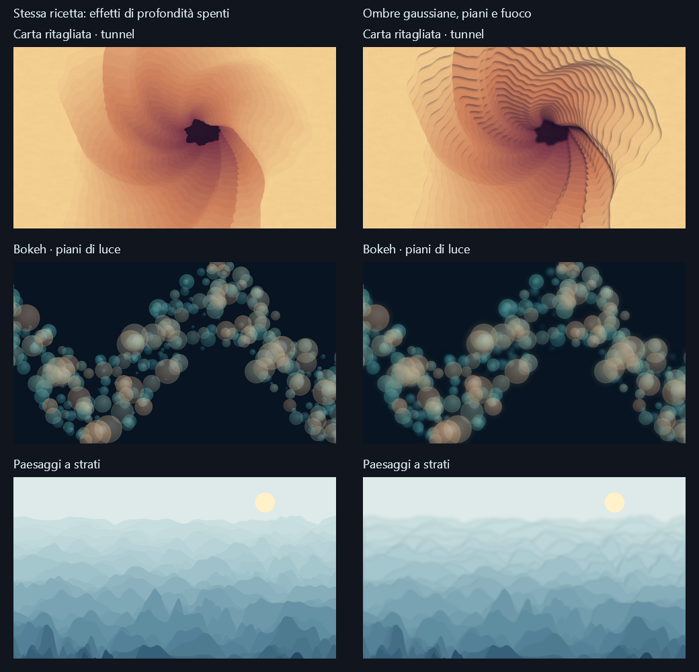

# M4D.3-R1 — Carta ritagliata, bokeh e profondità

16 novembre 2026. **17 generatori, 73 ricette, build Release senza avvisi/errori e 801/801 test Windows**. Due nuovi generatori e dieci ricette Full HD; Paesaggi a strati arricchito con ombre gaussiane, rilievi lontani sfocati e bordi luminosi. Nessuna nuova dipendenza di produzione.

## Confronto visivo

Stessa ricetta, seed, geometria e output **1920×1080** nelle due colonne. A sinistra sono disattivati solo `depth-blur`, ombre proiettate, glow e rim-light quando presenti; a destra i valori della ricetta. Nel bokeh restano attivi i gradienti di illuminazione dei dischi in entrambe le colonne. Le anteprime sono medie d'area 4×4 in alpha premoltiplicato.



Parametri esatti in [`validation/M4D3_R1_comparison-parameters.json`](validation/M4D3_R1_comparison-parameters.json). I confronti non cambiano seed o densità per accentuare il risultato.

## Carta ritagliata · tunnel

Artwork `paper-cut`. L'algoritmo `OrganicAperture` combina lobi armonici e noise Simplex campionato sul cerchio a due frequenze: il contorno è chiuso senza una cucitura discontinua. Ogni foglio ha una vera apertura trasparente: il riempimento even-odd conserva gli strati sottostanti. Si disegna dal fondo al fronte, con ombra della sagoma, bordo luminoso e sfocatura del piano.

| Gruppo | Controlli |
| --- | --- |
| Strati | `layers` 3–64; `inner-radius`, `outer-radius` relativi al lato minimo; `layer-bias` per la progressione della distanza |
| Geometria | `lobes` 1–24, `ripple`, `roughness`, `twist` fra fondo e fronte, `drift` del centro |
| Inquadratura | `stretch`, `rotation`, `center-x`, `center-y` |
| Dettaglio | `samples` 64–4096 per apertura; `rim-light`, `rim-width` |
| Profondità | Opacità/softness/distanza ombra, direzione luce, blur, piano a fuoco e ampiezza della zona nitida |
| Colori | Palette lagoon/canyon/ivory; sfondo, tre toni per profondità, luce e ombra indipendenti, tutti con alpha |

Per un tunnel regolare partire da ripple/roughness contenuti, ridurre drift e twist, quindi aumentare i fogli. Twist e deriva forti possono intersecare i contorni e creare un effetto collage. L'intervallo interno deve restare minore di quello esterno: la validazione segnala l'errore prima del rendering.

## Bokeh · piani di luce

Artwork `bokeh-depth`. `DepthParticleField` genera particelle con posizione, profondità, taglia e luminosità seeded, ordinate dal fondo al fronte. Il renderer le raggruppa in piani; ciascuno può avere alone diffuso, ombra e blur secondo la distanza dal fuoco. I dischi hanno un gradiente radiale illuminato e un anello opzionale.

| Gruppo | Controlli |
| --- | --- |
| Distribuzione | `particles` 1–4000; `layout` cloud/spiral/flow; `spread`; `turns` per le spire/onde |
| Piani | `planes` 3–32; più piani rendono più graduale la variazione del fuoco, con costo raster maggiore |
| Dischi | `radius`, `depth-scale` per ingrandire il primo piano, `opacity`, `aperture-ring` |
| Luce | `light-angle`, `light-strength`, `glow` per piano |
| Fuoco | `depth-blur`, `focus` da 0 fondo a 1 fronte, `focus-range` per l'ampiezza della zona nitida |
| Colori | Palette aurora/amber/pearl; sfondo, tre toni per profondità, luce e ombra con alpha indipendente |

La sfocatura usa il centro di ciascun piano, mentre dimensioni e colore usano la profondità effettiva della particella. Una zona nitida larga rende meno evidente il blur; per un bokeh più marcato restringerla e aumentare `depth-blur`. Per una velatura luminosa aumentare glow e ridurre l'opacità dei dischi. Sono composizioni pittoriche procedurali, senza ray tracing o simulazione ottica di una lente.

## Paesaggi esistenti migliorati

Sei nuovi parametri **opzionali nei JSON v1**:

| Parametro | Default catalogo | Funzione |
| --- | --- | --- |
| `depth-blur` | 0 | Sfocatura dei rilievi lontani, decrescente fino al primo piano nitido |
| `soft-shadow` | 0 | Opacità dell'ombra gaussiana della sagoma |
| `soft-shadow-softness` | 6 | Sigma dell'ombra |
| `soft-shadow-distance` | 8 | Spostamento dell'ombra |
| `light-angle` | −55° | Direzione della luce; l'ombra è proiettata dalla parte opposta |
| `rim-light` | 0 | Luce lungo la sommità dei profili |

Quando `soft-shadow` è maggiore di zero sostituisce la precedente ombra a tre tratti. Con tutti gli effetti nuovi spenti rimane il percorso storico. I **nuovi lavori Studio** partono con depth-blur 6, soft-shadow 0,22, softness 5, distanza 8 e rim-light 0,18; le ricette caricate mantengono i propri valori. Cielo/sole restano separati dal blur dei rilievi.

## Unità e compositore riutilizzabile

Le misure di blur, ombra, raggio bokeh e spessori sono riferite a **lato minimo 1000 px**, poi scalate sulla risoluzione logica. Softness/blur sono sigma gaussiani. Le direzioni angolari usano gli assi del canvas: X a destra, Y verso il basso. Colore dell'ombra e opacità si moltiplicano; un colore ombra trasparente può quindi annullare l'effetto.

`SkiaRasterSurface.DrawLayer` e `LayerEffects` implementano un gruppo SrcOver con blur gaussiano, drop shadow e opacità di gruppo, su raster premoltiplicato. L'opacità si applica una volta all'intero gruppo. Gli effetti neutrali chiamano direttamente il disegno, preservando la codifica storica. Il livello viene ripristinato anche se la callback fallisce o viene cancellata. Un solo livello filtrato è attivo alla volta; ogni piano è rilasciato prima del successivo. Il post-processing cartaceo/grana/dithering continua ad agire dopo il downsampling finale.

È una base di compositing riutilizzabile già usata da tre generatori. **M4C.3 resta aperta** per un editor di livelli, maschere arbitrarie e modalità di fusione configurabili nelle ricette. Non ci sono gerarchie illimitate di superfici o un nuovo schema JSON.

## Dieci nuove ricette

Tutti i file sono 1920×1080. Aprirli nello Studio oppure usare `render-recipe` con una destinazione nuova. Il catalogo contiene ora **73 JSON**.

| Ricetta | Carattere | Qualità |
| --- | --- | --- |
| [paper-cut-lagoon-portal-1920](../examples/recipes/paper-cut-lagoon-portal-1920.json) | 24 fogli, turchese/carta, ombre interne e trama cotone | standard |
| [paper-cut-canyon-vortex-1920](../examples/recipes/paper-cut-canyon-vortex-1920.json) | 28 fogli caldi, rotazione/deriva e carta ruvida | standard |
| [paper-cut-ivory-petal-1920](../examples/recipes/paper-cut-ivory-petal-1920.json) | 20 fogli avorio, nove lobi e bordi luminosi | fine-2x |
| [paper-cut-nocturne-1920](../examples/recipes/paper-cut-nocturne-1920.json) | 32 fogli notturni, quattro lobi, twist inverso e fondo sfocato | standard |
| [bokeh-aurora-current-1920](../examples/recipes/bokeh-aurora-current-1920.json) | 420 particelle lungo correnti, fuoco verso il fronte | standard |
| [bokeh-amber-spiral-1920](../examples/recipes/bokeh-amber-spiral-1920.json) | 520 luci ambrate a spirale, 18 piani | standard |
| [bokeh-pearl-mist-1920](../examples/recipes/bokeh-pearl-mist-1920.json) | 700 dischi piccoli perlati su 16 piani | standard |
| [bokeh-pearl-orbit-fine-1920](../examples/recipes/bokeh-pearl-orbit-fine-1920.json) | 280 particelle, anelli visibili e luce modellata | fine-2x |
| [strata-glacier-atmosphere-1920](../examples/recipes/strata-glacier-atmosphere-1920.json) | 32 rilievi glaciali, lontananza sfocata e ombre morbide | standard |
| [strata-desert-soft-light-1920](../examples/recipes/strata-desert-soft-light-1920.json) | 28 dune calde, bordi luminosi e cotone | standard |

Anteprime omonime in [`examples/previews`](../examples/previews).

## Budget e verifiche

- I controlli vengono verificati prima dell'allocazione della superficie e della scrittura del PNG. Restano i limiti generali 4096 per lato e 16.777.216 pixel, oltre al budget fine-2x.
- I nuovi artwork e i paesaggi con effetti filtrati hanno un massimo di **8.388.608 pixel nativi**, compreso il fattore 4 di fine-2x. Minimo 64 px per lato. Per carta: massimo 150.000 vertici complessivi; per paesaggi resta il precedente limite di 250.000.
- Il lavoro filtrato è limitato da `pixelNativi × passaggi × (1 + sigmaNativoMassimo / 12) ≤ 800.000.000`. Il modello usa conservativamente la somma dei sigma; il glow aggiunge un passaggio per piano. Non è una stima della RAM. Sono vietati livelli filtrati annidati.
- Bokeh: anche `particles × (radius × depth-scale)² ≤ 160.000.000`, in unità di riferimento. I massimi dei singoli slider non sono necessariamente ammessi tutti insieme.
- Cancellazione nelle geometrie, fra piani e gruppi di particelle; una singola operazione nativa Skia non è interrompibile a metà. Nessun accumulo di fotogrammi.

**Windows / .NET SDK 10.0.201:** `tools/validate.ps1` completato, build Release zero avvisi/errori, **801/801 test**: Core 115, Algorithms 168, Application 134, Rendering.Skia 384. Test su chiusura dei contorni, seed, ordinamento, controlli visivi, alpha del blur senza bordi neri, ombra direzionale, opacità di gruppo, ripristino del canvas, cancellazione, budget prima dell'output, JSON e qualità 2×.

I quindici PNG dei generatori precedenti, con default catalogo, seed 42 e 160×120 (loop frame 0/4), sono identici ai PNG catturati prima delle modifiche. Il confronto riguarda questi casi, non ogni possibile input. Gli hash sono ripetibili con `depth-compat`.

Dieci ricette Full HD renderizzate e decodificate, comprese le due fine-2x; tutte le 73 ricette validate. Tempi locali circa **1,2–3,7 s** per ricetta e picco working set del processo **234.389.504 byte, circa 224 MiB**. Il picco è cumulativo del processo di smoke, non un benchmark isolato. Export CLI del portale lagoon verificato con PNG identico al runtime headless.

Smoke Studio headless: 29 slider carta, 23 bokeh, 29 paesaggio, ruoli colore e scelte, nuovi default e ripristino JSON, input decimale esatto e slider fini. Screenshot README catturato dallo Studio reale in modalità headless. Misure e log in [`validation`](validation), prefisso `M4D3_R1_`.

Per ripetere i controlli opzionali:

```powershell
dotnet run --project .\tools\GenerativeArt.Smoke -c Release -- depth-studio .
dotnet run --project .\tools\GenerativeArt.Smoke -c Release -- depth .
dotnet run --project .\tools\GenerativeArt.Smoke -c Release -- depth-compare .
dotnet run --project .\tools\GenerativeArt.Smoke -c Release -- depth-compat .
```

Il tool opzionale usa Avalonia.Headless 12.1.4 e resta fuori dalla solution di produzione; Avalonia/SkiaSharp dell'applicazione sono invariati. Nell'ambiente Codex il ripristino usa la cache NuGet locale, pacchetti sotto `artifacts/nuget`, audit online disattivato e telemetria di build disattivata; non sono modificati sorgenti NuGet o configurazioni globali. Restano da verificare desktop/DPI reali, nuovi poster 4K, altri OS e animazioni lunghe.
