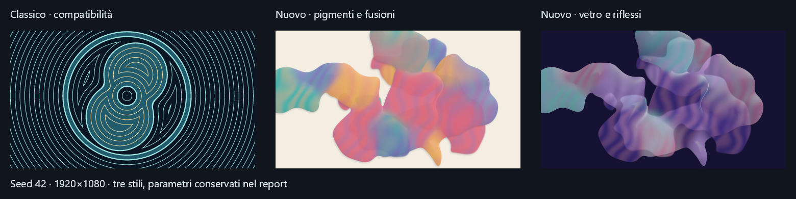
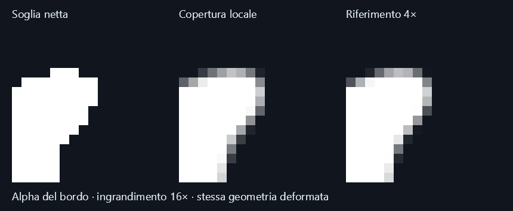

# M4D.4-R1 — Orbite SDF: macchie e fusioni

16 novembre 2026. Orbite SDF è stato riprogettato con **macchie organiche, fusione di quattro pigmenti, venature, rilievo e piani sovrapposti**, mantenendo il vecchio disegno come stile di compatibilità. **17 generatori, 81 ricette, build Release senza avvisi/errori e 859/859 test Windows**. Otto nuove ricette Full HD, due fine-2x. Nessuna nuova dipendenza di produzione.

## Confronto

Seed **42**, output **1920×1080** in tutte le colonne. A sinistra i default del catalogo storico; al centro i nuovi default Studio; a destra una variante glass con palette iris e riflessi più forti. I tre stili hanno parametri/palette propri, conservati nel [report](validation/M4D4_R1_comparison-parameters.json). Le anteprime usano la media d'area 4×4 in alpha premoltiplicato.



## Uso nello Studio

Selezionare **Orbite SDF · macchie e fusioni**: un nuovo lavoro parte in stile **pigment**, palette sorbet, due piani e quattordici macchie per piano. Il controllo **Stile SDF** appare nel primo gruppo. Le ricette precedenti senza `style` si aprono in **classic** e conservano la vecchia resa; per trasformarle scegliere pigment/glass oppure aprire uno dei nuovi preset.

- **pigment:** macchie con opacità, colore e rilievo regolabili; si presta a colate, isole cromatiche e velature.
- **glass:** opacità dei piani moltiplicata per 0,72 e riflessi più concentrati; usare highlight e relief per accentuare il volume.
- **classic:** composizione CSG originaria, con sottrazioni e anelli. Le nuove opzioni di macchie, pigmenti e profondità sono usate nei due stili moderni.

I colori si possono mescolare in **linear**, media in RGB lineare, oppure **pigment**, media logaritmica delle componenti lineari, più scura nelle sovrapposizioni. La seconda è un'approssimazione pittorica, non una simulazione fisica dei pigmenti. Le fusioni avvengono nel campo cromatico di ciascun piano; fra piani si usa SrcOver, con alpha premoltiplicato nel raster.

## Geometria e complessità

`PigmentSdfField` genera ellissi seeded con variazioni di raggio, orientamento e proporzioni. Un'unione morbida polinomiale collega le forme, mentre due campi Simplex deformano il dominio. I pesi cromatici locali vengono normalizzati separatamente dalla geometria: aumentare `color-mix` modifica le transizioni di colore senza spostare le sagome. Le distanze delle ellissi deformate sono approssimate; l'antialiasing ne misura la variazione sul raster.

| Gruppo | Controlli e significato |
| --- | --- |
| Composizione | `layout` cluster/orbital/river; `blobs` 2–40 per piano; `layers` 1–6 |
| Macchie | `blob-radius` 0,03–0,36 del lato minimo; `radius-variation`; `elongation` 1–3; `spread` 0,1–1,5 |
| Fusione geometrica | `smoothness` 0,002–0,2; valori maggiori collegano più facilmente le macchie |
| Deformazione | `warp-amount` 0–0,2; `warp-frequency` 0,3–10 |
| Pigmenti | `color-mix`, `color-mode`, `marbling`, `marble-frequency`, `opacity` |
| Contorni | `contour-opacity` per fasce interne; `bands` per densità; `outline` per il bordo esterno; `edge-width` per lo spessore |
| Inquadratura | `shape-scale`, `rotation`, `stretch-x/y`, `center-x/y` |
| Luce | `relief`, `highlight`, `light-angle` |
| Profondità | `shadow-opacity`, `shadow-softness`, `shadow-distance`, `depth-blur` |

Le venature redistribuiscono gradualmente i pesi dei pigmenti lungo un campo sinusoidale deformato da noise. `marbling = 0` le disattiva. Le fasce SDF non sono obbligatorie: impostare `contour-opacity` e `outline` a zero per avere solo macchie e colori. `bands` agisce quando le fasce interne sono visibili. Riflessi/illuminazione e opacità possono essere ridotti a zero/valori minimi per ottenere campiture più piatte.

Per macchie distinte ridurre raggio e smoothness, aumentare spread, quindi regolare warp. Per colate fuse aumentare smoothness e raggio. Per conservare colori più riconoscibili ridurre color-mix e marbling; aumentare color-mix per passaggi più ampi e morbidi. Crop e sovrapposizioni sono intenzionali: ridurre shape-scale o raggio per lasciare più margine al canvas.

## Colori e profondità

Sei palette: **mineral, ember, iris, sorbet, lagoon, nocturne**. I ruoli storici vengono riutilizzati, senza cambiare gli ID JSON:

| Ruolo | Nuovi stili | Classico |
| --- | --- | --- |
| `background-color` | Sfondo | Sfondo |
| `fill-color` | Pigmento 1 | Riempimento |
| `ink-color` | Pigmento 2 | Linee principali |
| `accent-color` | Pigmento 3 | Linee secondarie |
| `pigment-color-4` | Pigmento 4 | Non usato |
| `shadow-color` | Ombra proiettata | Non usato |

Tutti i ruoli accettano Auto oppure HEX con alpha. Nella miscela i colori sono pesati anche per alpha: il RGB nascosto di un pigmento totalmente trasparente non contamina gli altri. Sfondo trasparente, ombre e bordi parzialmente coperti rimangono trasparenti nel PNG.

Ogni piano contiene un campo distinto ma stabile per seed, con scala crescente dal fondo al fronte. Il rilievo usa le derivate del campo misurate a schermo; la luce modella i bordi e aggiunge riflessi. Ombre gaussiane e blur dei piani lontani usano `DrawLayer`/`LayerEffects` introdotti in M4D.3, un piano alla volta. La sfocatura è massima sul fondo e si annulla sul primo piano; con un solo piano il depth-blur non è applicato. Softness e distanza ombra sono riferite al lato minimo 1000 px; light-angle usa X verso destra, Y verso il basso.

## Antialiasing

Il nuovo percorso calcola la copertura graduata del bordo usando il **footprint locale** della distanza, stimato con differenze centrali X/Y su tre righe di campioni. La larghezza si adatta a scala, allungamento, deformazione e risoluzione. Le fasce interne usano l'integrale locale di un tratto su un pixel box: un tratto subpixel mantiene un'intensità proporzionale allo spessore, anziché lampeggiare fra assente e pieno. Questo antialiasing è attivo anche in **standard**; fine-2x aggiunge il supersampling e la riduzione premoltiplicata già disponibili.



Stessa geometria deformata, seed 42, immagine 128×96, dettaglio 16×. Nel [caso registrato](validation/M4D4_R1_antialiasing-report.json), su 381 pixel di bordo l'errore medio assoluto dell'alpha rispetto al riferimento renderizzato 4× e mediato è **14,35/255**, contro **49,93/255** per la soglia netta: riduzione **71,3%**. È una misura su questo caso, non una garanzia per qualsiasi impostazione. Anche un caso senza deformazione è coperto dalla suite. Il classico conserva il vecchio campionamento per riprodurre i PNG precedenti.

## Otto ricette Full HD

| File | Resa | Qualità |
| --- | --- | --- |
| [sdf-sorbet-pigment-1920](../examples/recipes/sdf-sorbet-pigment-1920.json) | Macchie corallo/ocra/turchese/viola, due piani e fusione lineare | standard |
| [sdf-lagoon-river-1920](../examples/recipes/sdf-lagoon-river-1920.json) | Colate lungo un fiume sinusoidale, venature e toni laguna | standard |
| [sdf-iris-glass-1920](../examples/recipes/sdf-iris-glass-1920.json) | Orbite organiche, trasparenze, rilievo e riflessi viola | standard |
| [sdf-nocturne-marble-1920](../examples/recipes/sdf-nocturne-marble-1920.json) | Quattro piani, deformazione forte e venature notturne | standard |
| [sdf-ember-islands-1920](../examples/recipes/sdf-ember-islands-1920.json) | Isole calde separate, senza fasce o contorni | standard |
| [sdf-sorbet-fused-fine-1920](../examples/recipes/sdf-sorbet-fused-fine-1920.json) | Macchie grandi molto fuse e venature morbide | fine-2x |
| [sdf-lagoon-ink-wash-1920](../examples/recipes/sdf-lagoon-ink-wash-1920.json) | Un piano, rilievo tenue, cotone, pigmento e assorbimento | standard |
| [sdf-nocturne-glass-fine-1920](../examples/recipes/sdf-nocturne-glass-fine-1920.json) | Trasparenze notturne, riflessi forti e ombre più distanti | fine-2x |

Anteprime omonime in [`examples/previews`](../examples/previews). Le ricette sono 81 in totale.

## Compatibilità e limiti

- ID `sdf-orbits`, algorithmVersion 1 e JSON v1 conservati. I 31 nuovi controlli sono facoltativi nei vecchi JSON. Il default catalogo di style resta classic; il nuovo lavoro Studio seleziona pigment. Le ricette importate non ricevono i default Studio.
- Classico con palette storiche mantiene i PNG precedenti: verifica hash dei quindici renderer precedenti, SDF incluso, a seed 42 / 160×120. Le nuove palette sono utilizzabili anche nel classico.
- Nuovi stili: minimo 64 px per lato; **8.388.608 pixel nativi**, quindi massimo 2.097.152 pixel finali in fine-2x, sufficiente per Full HD. Restano i limiti globali 4096 per lato e quelli del raster/finiture.
- Budget SDF prima delle superfici/output: `(larghezzaNativa + 2) × (altezzaNativa + 2) × piani × macchie ≤ 260.000.000`. I nuovi default Studio Full HD sono ammessi anche in fine-2x. I massimi di tutti gli slider insieme possono superare il budget.
- Si applica anche `DepthLayerPolicy`: 800 milioni di unità raster filtrate. Per i piani, il sigma conservativo è depth-blur + shadow-softness, scalato sulla risoluzione nativa.
- Un solo PixelBuffer riutilizzato fra i piani e tre righe di campioni; nessun campo float a pieno canvas, nessuna cache di frame. Cancellazione durante il campionamento e fra piani; un filtro nativo Skia non è interrompibile a metà.
- Il compositing rimane SrcOver e i riflessi sono pittorici; non ci sono rifrazione fisica, tracciamento di raggi o simulazione fluida.

## Verifiche e riproduzione

**Windows, SDK 10.0.201:** `tools/validate.ps1` completato, build Release zero avvisi/errori, **859/859 test**: Core 115, Algorithms 175, Application 135, Rendering.Skia 434. Test su campo seeded, pesi cromatici normalizzati, separazione colore/geometria, conservazione dei tratti sottili, copertura contro riferimento 4×, alpha senza aloni neri, pigmenti trasparenti, tutti i controlli, JSON, budget e cancellazione.

Tutte le **81 ricette validate**, otto nuovi PNG Full HD renderizzati/decodificati, due fine-2x; smoke Studio su SDF (36 controlli numerici), carta e Domain Warp, con ripristino, colori/scelte e input numerico esatto. Quindici PNG precedenti identici. Evidenze in [`validation`](validation), prefisso `M4D4_R1_`.

Tempi locali circa **1,2–3,6 s** per ricetta, picco working set cumulativo del processo di smoke **267.902.976 byte, circa 256 MiB**. Export CLI della ricetta sorbet fine-2x identico al PNG del runtime headless. Screenshot README catturato dallo Studio reale in modalità headless.

```powershell
dotnet run --project .\tools\GenerativeArt.Smoke -c Release -- sdf-studio .
dotnet run --project .\tools\GenerativeArt.Smoke -c Release -- sdf .
dotnet run --project .\tools\GenerativeArt.Smoke -c Release -- sdf-compare .
dotnet run --project .\tools\GenerativeArt.Smoke -c Release -- sdf-aa .
dotnet run --project .\tools\GenerativeArt.Smoke -c Release -- depth-compat .
```

Il tool headless resta opzionale e fuori dalla solution. In Codex: restore dalla cache NuGet locale verso `artifacts/nuget`, audit online e telemetria build disattivati, nessuna configurazione globale modificata. I tempi/picchi di memoria nel report sono locali al processo di smoke; desktop/DPI reali, altri OS e nuovi poster 4K restano da verificare.
