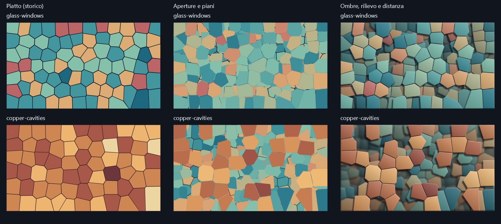

# M4E.4-V1-R1 — Voronoi con aperture e mosaici in profondità

17 novembre 2026. Evoluzione del generatore `voronoi-mosaic`: **tessere mancanti che rivelano altri mosaici**, piani indipendenti con tessere più fitte sul fondo, ombre fra piani, smussi illuminati, oscuramento, atmosfera e sfocatura crescente con la distanza. **30 generatori, 30 preset incorporati, 182 ricette; build Release senza avvisi/errori e 1.260/1.260 test Windows**.

## Provarlo subito

Nello Studio selezionare **Mosaico Voronoi**, poi **Composizione del mosaico → layered**. In alternativa aprire una delle sei ricette in [`examples/recipes/voronoi-depth-v1`](../examples/recipes/voronoi-depth-v1).

Il valore `flat` conserva la resa precedente. Il preset personale Voronoi e tutti gli altri 29 file incorporati rimangono identici: non vengono sostituiti seed, colori, finiture o qualità scelti dall'utente. La modalità stratificata è attivabile sui loro parametri esistenti; quando si torna a flat i controlli nuovi sono disabilitati e i valori conservati.

## Confronto visivo

Stessi seed, dimensioni **1920×1080**, siti in primo piano, rilassamento e parametri di base per ogni riga. Da sinistra:

1. Percorso piatto storico.
2. Aperture e piani, con ombre, rilievo, blur, oscuramento e atmosfera spenti.
3. Stessi piani e aperture con tutti gli effetti della ricetta attivi.



Il percorso moderno interpola anche i cinque colori della palette, mentre il piatto storico conserva la selezione discreta dei colori e gli accenti originali. Le anteprime sono medie d'area 4×4 in alpha premoltiplicato. [Parametri esatti dei confronti](validation/VORONOI_V1_R1_comparison-parameters.json).

## Aperture e piani reali

`VoronoiLayerPlan` costruisce un mosaico per piano con griglia di semi jittered e rilassamento di Lloyd. Ogni piano ha un seed derivato stabile e una diversa disposizione. Quello davanti conserva la disposizione prodotta dalla semina storica a parità di seed, siti e rilassamento.

Le aperture **omettono il disegno delle tessere**, senza riempirle con il colore dello sfondo. Il rendering procede dal fondo al fronte; i mosaici posteriori restano quindi visibili. Il piano più lontano mantiene tutte le tessere, con le proprie fughe: non lascia aperture aggiuntive casuali verso lo sfondo.

`missing-tiles` rimuove esattamente `floor(numeroTessere × frazione)` celle da ciascun piano salvo l'ultimo. La quota riguarda il **numero**, non l'area dei poligoni. Aumentarla aggiunge aperture senza spostare la geometria o riassegnare i colori alle tessere rimaste. `random` distribuisce i vuoti casualmente, `clustered` li concentra con un campo noise. Con valore 1 scompaiono tutti i piani davanti al mosaico di fondo.

La distanza è costruita combinando mosaici posteriori più densi, scarto dei semi, minore luminosità, velatura e blur. Sono effetti pittorici 2D: non si tratta di una scena tridimensionale con ray tracing.

## Controlli

I **22 nuovi parametri** sono opzionali nei JSON v1. Lo Studio espone complessivamente **27 controlli numerici e 10 ruoli colore** per Voronoi, oltre a scelte e finiture.

| Gruppo | Parametri | Uso |
| --- | --- | --- |
| Piani | `depth-style`, `depth-layers` 2–8 | Attivazione e numero dei mosaici |
| Aperture | `missing-tiles` 0–1, `hole-pattern` random/clustered | Quantità e distribuzione delle tessere assenti |
| Prospettiva | `back-density` 1–3 | Moltiplicatore di densità fra fronte e fondo; massimo 256 siti per piano arretrato |
| Scarto | `parallax-x`, `parallax-y` −120…120 | Spostamento dei semi per intervallo fra piani, su lato minimo 1000 px |
| Distanza | `distance-dimming`, `atmosphere`, `depth-blur` | Oscuramento, velatura e sigma gaussiano crescenti verso il fondo |
| Palette | `back-palette` same/glass/copper/lagoon | Palette dei piani posteriori |
| Ombre | `shadow-opacity`, `shadow-softness`, `shadow-distance` | Opacità, sigma e spostamento dell'ombra della sagoma del piano |
| Luce | `light-angle` | Direzione luce per ombre e smussi |
| Tessere | `tile-relief`, `bevel-width`, `edge-opacity` | Volume della faccia, ampiezza dello smusso e contorno |
| Toni | `tile-variation`, `accent-strength` | Variazione cromatica per cella e inserti luminosi opzionali |
| Colori aggiuntivi | `shadow-color`, `depth-color` | Ombra proiettata e colore della velatura |

Softness, blur, smusso, spostamenti e scarti sono riferiti al **lato minimo 1000 px** e scalati sulla risoluzione logica. La fuga `gutter` mantiene il riferimento storico a 800 px. Light-angle usa X verso destra e Y verso il basso; l'ombra è proiettata dalla parte opposta alla luce. `depth-blur` indica il sigma massimo sul fondo, con primo piano nitido.

I cinque override `tile-color-1` … `tile-color-5` si applicano a tutti i piani. Se sono tutti personalizzati, sostituiscono anche la palette posteriore e il relativo controllo viene disabilitato con spiegazione. Con valori Auto si può scegliere una diversa palette sul fondo. Sfondo, contorni e accenti storici rimangono editabili; shadow-color e depth-color accettano HEX con alpha.

Per cavità profonde aumentare ombra e scarto, oscurare il fondo e lasciare il primo piano luminoso. Per vedere chiaramente più mosaici usare aperture fra 0,35 e 0,60 e 3–5 piani; blur eccessivo può far perdere la lettura delle tessere posteriori. Per buchi più isolati scegliere random; per lacune ampie scegliere clustered.

## Materiale e compositing

`DrawBeveledConvexPolygon` disegna una faccia con gradiente direzionale e smussi più chiari/scuri secondo la normale del bordo. Le regioni interne sono disgiunte, con antialiasing sul contorno esterno: faccia e smusso non sommano due volte la trasparenza. La larghezza dello smusso è limitata in rapporto alla dimensione della cella per non consumare le tessere piccole.

`DrawLayer`/`LayerEffects` applicano blur e ombre gaussiane alla sagoma dell'intero piano, comprese le aperture. Il piano di fondo non proietta un'ulteriore ombra. Si compone un livello filtrato alla volta, senza annidamenti o accumulo di superfici. Le finiture carta/grana/pigmenti restano dopo il downsampling finale.

La velatura modifica il tono senza rendere opachi i pigmenti trasparenti; la sua alpha controlla la forza della tinta atmosferica. L'alpha del colore ombra si moltiplica con shadow-opacity. Una ricetta dedicata mostra le tessere semitrasparenti su sfondo trasparente.

## Sei nuove ricette

| Ricetta | Carattere | Qualità |
| --- | --- | --- |
| [glass-windows](../examples/recipes/voronoi-depth-v1/voronoi-depth-glass-windows-1920.json) | Quattro piani, 42% di tessere mancanti, fughe profonde e smussi | fine-2x |
| [copper-cavities](../examples/recipes/voronoi-depth-v1/voronoi-depth-copper-cavities-1920.json) | Cinque piani, rame sul fronte e mosaici freddi dietro, aperture al 55% | standard |
| [lagoon-fragments](../examples/recipes/voronoi-depth-v1/voronoi-depth-lagoon-fragments-1920.json) | Quattro piani laguna con aperture random e fondo caldo | standard |
| [night-wells](../examples/recipes/voronoi-depth-v1/voronoi-depth-night-wells-1920.json) | Sei piani notturni, ombre marcate e fondo molto sfocato | fine-2x |
| [ivory-ruins](../examples/recipes/voronoi-depth-v1/voronoi-depth-ivory-ruins-1920.json) | Cinque piani avorio, vuoti random e finitura cotone/grana | standard |
| [transparent](../examples/recipes/voronoi-depth-v1/voronoi-depth-transparent-1920.json) | Tre piani, tessere semitrasparenti e sfondo alpha | standard |

Tutte sono **1920×1080**. Anteprime omonime in [`examples/previews`](../examples/previews). Le 176 ricette precedenti rimangono disponibili; totale 182, con 30 generatori e 30 preset incorporati.

## Budget e compatibilità

- Modalità flat: percorso storico e supporto 8K UHD preesistenti conservati. I nuovi controlli non cambiano i PNG finché non si sceglie layered.
- Modalità layered: minimo 64 px per lato, **8.388.608 pixel nativi** compreso il fattore quattro di fine-2x. Full HD è ammesso anche fine-2x. Questo percorso filtrato non abilita 8K.
- Massimo **1.400 celle** complessive; lavoro geometrico `somma(sitiPiano² × (relaxations + 1)) ≤ 1.600.000`. Il fronte mantiene il limite storico di 196 siti, il fondo cresce fino a 256 per piano.
- Si applica anche `DepthLayerPolicy`: `pixelNativi × piani × (1 + sigmaNativoConservativo / 12) ≤ 800.000.000`, con sigma conservativo dato da depth-blur + shadow-softness. È un modello di lavoro, non una stima della RAM.
- Tutti i budget sono validati prima della superficie e dell'output; cancellazione nella generazione, nel rilassamento, nella selezione dei vuoti e fra celle/piani. Una singola operazione nativa Skia non è interrompibile a metà.
- ID `voronoi-mosaic`, algorithmVersion 1 e JSON v1 conservati. I file dei 30 preset incorporati sono **identici byte per byte**, inclusi i 17 personali. Nessuna modifica a Crinis o Cincinnus.

## Verifiche eseguite

**Windows, SDK 10.0.201: `tools/validate.ps1` completato**, clean/restore/build Release senza avvisi/errori e **1.260/1.260 test**: Core 115, Algorithms 254, Application 220, Rendering.Skia 671. Il gate rapido Application conta 21 test già inclusi nel totale.

La suite verifica quota esatta e progressiva dei vuoti, stabilità della geometria, partizione del canvas, scaling, determinismo, JSON, effettiva visibilità del mosaico posteriore, alpha dei materiali/smussi, controlli creativi, budget prima dell'output, cancellazione e mantenimento dell'8K flat.

- **182 ricette validate**; sei nuovi PNG Full HD renderizzati e decodificati, incluse le due fine-2x.
- Confronto dei quattro PNG catturati prima delle modifiche: standard, fine-2x, trasparenza copper e preset personale Full HD. Hash identici per questi casi, senza estendere la conclusione a ogni input possibile. [Dati e input originali](validation/VORONOI_V1_R1_compatibility.json).
- Studio headless: passaggio reale del selettore flat→layered, attivazione controlli, sei import con valori conservati, 27 slider e 10 campioni colore. Screenshot README catturato dallo Studio reale, con anteprima nativa 1920×1080 adattata al riquadro.
- Export CLI glass-windows fine-2x identico al PNG del renderer comune. [Report CLI](validation/VORONOI_V1_R1_cli-report.json).
- Tempi locali circa **0,47–1,58 s** per PNG; picco working set cumulativo **322.109.440 byte, circa 307 MiB**. Sono misure del processo di smoke, non benchmark isolati. [Report render](validation/VORONOI_V1_R1_render-report.json).

Log in [`validation`](validation), prefisso `VORONOI_V1_R1_`. Per ripetere gli smoke:

```powershell
dotnet run --project .\tools\GenerativeArt.Smoke -c Release -- voronoi .
dotnet run --project .\tools\GenerativeArt.Smoke -c Release -- voronoi-studio .
dotnet run --project .\tools\GenerativeArt.Smoke -c Release -- voronoi-compare .
dotnet run --project .\tools\GenerativeArt.Smoke -c Release -- voronoi-compat .
```

Il tool opzionale usa Avalonia.Headless 12.1.4 fuori dalla solution, senza nuove dipendenze di produzione. In Codex il restore usa la cache NuGet locale e pacchetti sotto artifacts/nuget, con audit online e telemetria build disattivati; nessuna configurazione globale modificata. Restano aperti il giudizio artistico dell'utente, desktop/DPI reali, altri OS e stress 4K/8K specifici. L'editor universale di livelli/maschere/blend resta una fase distinta.
